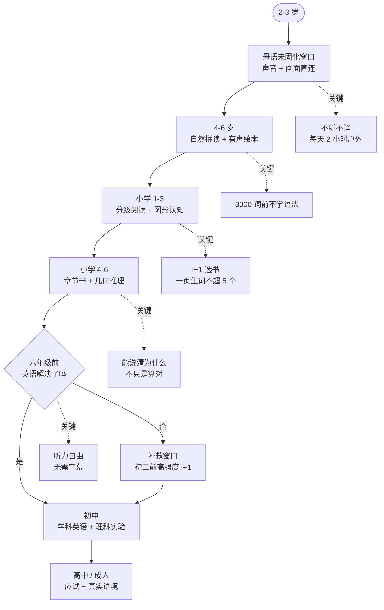

# 学习路线图

按年龄排的阶段目标。每个阶段写清三件事：**这个阶段要完成什么**、**用什么资源完成**、**怎么判断完成了**。

判断标准写具体一点，否则「学完了」是句空话。

---

## 整体路径

---

## 阶段一｜2-3 岁：打开窗口

| 项 | 内容 |
| --- | --- |
| **目标** | 建立「外语 = 好玩」的初始印象，让大脑开始建立声音与画面的直接映射 |
| **核心动作** | 每天 20-30 分钟有剧情的外语动画 |
| **资源** | [Starfall](https://www.starfall.com)、[PBS Kids](https://pbskids.org)、[Sesame Street](https://www.sesamestreet.org/) |
| **完成标志** | 孩子能跟着动画的节奏产生情绪反应（笑、紧张、模仿动作），说明他在跟剧情，不是在听音 |
| **常见错误** | 配中文字幕；边看边问「这个单词什么意思」；用教学视频代替动画 |

**不要做的事**：不要教字母，不要认单词，不要任何形式的考核。这个阶段唯一任务是让他喜欢上那个语言的声音。

**视力的正确解法**：每天 2 小时户外活动。把户外写进固定日程，视频时间反而可以放宽。减少屏幕时间是低效的做法——户外光照才是关键变量。

---

## 阶段二｜4-6 岁：建立解码能力

| 项 | 内容 |
| --- | --- |
| **目标** | 看到字母组合能读出来（拼读），读出来的词知道意思（听力词汇已经在） |
| **核心动作** | 自然拼读系统练习 + 每天一本有声绘本 |
| **资源** | [Reading Bear](https://www.readingbear.org)、[Storyline Online](https://www.storylineonline.net)、[StoryWeaver](https://storyweaver.org.in)、[自然拼读作业纸 270+ 页](03b-网盘资料清单.md#phonics_270) |
| **完成标志** | 给一个没见过的 CVC 词（如 `cat`、`pig`、`sun`），孩子能自己拼出来；听一个词能判断首音 |
| **常见错误** | 把拼读当规则背；作业纸一口气刷完；这个阶段就开始教语法 |

**270 页作业纸的用法**：每天 2-3 页，持续 4-6 个月。价值在「持续」，不在「完成」。拼读是肌肉记忆，靠重复建立，不靠理解。

**为什么不教语法**：语法要等有效词汇量到 3000 左右才有附着点。在此之前学，学到的规则没有实例支撑，记不住也用不上。

---

## 阶段三｜小学 1-3 年级：从听懂到读懂

| 项 | 内容 |
| --- | --- |
| **目标** | 把听力词汇转化成阅读词汇；建立图形与空间直觉 |
| **核心动作** | 分级读物每天 15-20 分钟 + 几何动画课每周 2-3 次 |
| **资源** | [Oxford Owl](https://www.oxfordowl.co.uk)、[Free Kids Books](https://freekidsbooks.org)、[范老师几何思维课 1-3 年级段](03b-网盘资料清单.md#fan_geometry_900)、[NRICH](https://nrich.maths.org) |
| **完成标志** | 英语：能独立读完一本分级读物并说出大意。数学：能说出「这个图形旋转之后会变成什么样」 |
| **常见错误** | 选书太难（一页生词超 5 个就该降级）；几何只刷计算题 |

### 英语 i+1 选书标准

翻开任意一页，数生词：

- 0-2 个：太简单，读着没进步但不影响，可以当消遣；
- 3-5 个：**刚好**，这是 i+1 的甜点区；
- 6 个以上：太难，换一本。

这个标准比任何分级体系都实用，因为它测的是**这本书对你家孩子**的难度，不是抽象级别。

### 几何的关键

这个阶段的目标不是算面积，是**看得懂图形怎么拼、怎么转、怎么切**。

纸质教材呈现旋转、展开、截面时，只能画成一组静态图，孩子要在脑子里把这几张图连起来。这一层拼接恰恰是很多人「数学不开窍」的来源。动画直接把这个过程演出来。

配合方法：

1. 看一集动画（看过程）；
2. 看第二遍，暂停在关键帧，让孩子预测「接下来会变成什么」；
3. 第三遍让孩子讲给你听；
4. 拿纸笔自己画一遍。

第 3 步是关键。「能讲清为什么」才是懂，「画对答案」只是记住了。

---

## 阶段四｜小学 4-6 年级：阅读量爆发 + 几何推理

| 项 | 内容 |
| --- | --- |
| **目标** | 从分级读物过渡到章节书；几何从「直观」推进到「能说清理由」；掌握盲打 |
| **核心动作** | 章节书每天 20-30 分钟 + 几何动画课每周 3 次 + 打字每周 2 次 |
| **资源** | [Free Kids Books](https://freekidsbooks.org) 章节书、[News in Levels](https://www.newsinlevels.com)、[范老师几何思维课 4-6 年级段](03b-网盘资料清单.md#fan_geometry_900)、[TypingClub](https://www.typingclub.com)、[Scratch 3.0 全套](03b-网盘资料清单.md#scratch_174) |
| **完成标志** | 英语：读完一本完整的原版章节书（哪怕薄）；数学：能口头解释「为什么这两个三角形面积相等」；打字：盲打 30 词/分钟 |
| **常见错误** | 指望学校教；只读不聊；几何只做计算 |

### 突破畏惧感

从「能读分级读物」到「能读章节书」，中间有一道心理门槛。跨过去的方法不是从最难的开始，是**认真读完几本薄的原版书**。

「认真读完」的标准：从头到尾一页不跳，读完能复述情节。

读完第一本之后，第二本会容易很多——不是因为词汇量涨了，是因为「我能读完一本英文书」这个信念建立了。

### 几何推理的转折

4-6 年级的几何不再是「看图说话」，是「说清理由」。

判断孩子是不是真的懂了，问一句：**「为什么？」**

- 「因为这两个三角形底一样高一样」——这是描述现象；
- 「因为它们是同一个平行四边形沿对角线分成的两半，而平行四边形对角线平分面积」——这是推理。

后者才算懂。

### 为什么这个阶段要练打字

写作和编程都需要打字速度。10 岁前练盲打，肌肉记忆形成快，之后终身受益。拖到初中，课业压力上来就没时间了。

---

## 阶段五｜六年级：检查点

这是整条路线最硬的一个节点。

| 项 | 内容 |
| --- | --- |
| **目标** | 英语达到「听力自由」——看无字幕的英语视频能跟上剧情 |
| **检验方法** | 找一段 2-3 分钟的英语原声（无字幕、无中文提示），孩子看完能说出发生了什么 |
| **如果没达到** | 进入补救路径，见下一节 |

**为什么是六年级**：初二之后课业压力陡增，再想靠每天 2-3 小时输入来突破，物理上做不到。六年级到初二之间是最后的窗口。

---

## 补救路径｜初二之前

如果六年级检查点没过，按这个顺序补：

| 优先级 | 动作 | 资源 | 时间 |
| --- | --- | --- | --- |
| 1 | 恢复视听输入，找孩子真正感兴趣的 | [Parrot 播客](https://parroto.app/zh-CN)、[看电影学英语](03b-网盘资料清单.md#learn_english_movies) | 每天 1-2 小时 |
| 2 | 高密度 i+1 阅读 | [News in Levels](https://www.newsinlevels.com)、[Simple English Wikipedia](https://simple.wikipedia.org/wiki/Main_Page) | 每天 30 分钟 |
| 3 | 语境化词汇 | [Wordly Wise 3000](03b-网盘资料清单.md#wordly_wise_3000)、[Tatoeba](https://tatoeba.org/en/) | 每天 20 分钟 |
| 4 | 语法（词汇量过 3000 后） | 学校教材或系统语法书 | 每周 2 次 |

**关键不是时间分配，是第 1 项能不能成立。** 如果孩子对这 1-2 小时的内容毫无兴趣，整条补救路径都会失败。找兴趣点比规划时间表重要得多。

---

## 阶段六｜初中：学科英语

| 项 | 内容 |
| --- | --- |
| **目标** | 用英语学其他科目（学科英语），理科实验抽象化 |
| **资源** | [BBC Bitesize](https://www.bbc.co.uk/bitesize)、[PhET](https://phet.colorado.edu)、[Simple English Wikipedia](https://simple.wikipedia.org/wiki/Main_Page)、[BodyVista](https://github.com/FreedomIntelligence/BodyVista)、[Atlas of Physics](https://github.com/nathanliow/atlas-of-physics) |
| **完成标志** | 能听懂英语讲的科学课；能用英语解释一个物理现象 |

十岁以后母语已固化，不能再指望「看动画自然习得」。这个阶段靠的是**大量、高密度的可理解输入**——让同一个词在几十种语境里反复出现，逐步磨掉「先翻译成中文再理解」的延迟。

---

## 阶段七｜高中 / 成人：应试与真实能力

| 项 | 内容 |
| --- | --- |
| **目标** | 考试分数 + 真实使用能力 |
| **第一步** | 先摸底：[Test-English](https://test-english.com) 或 [Cambridge English](https://www.cambridgeenglish.org) |
| **资源** | [IELTS Atlas](https://github.com/gtiipoi/ielts-practice)、[Word Atlas](https://github.com/designfuchen/word-atlas)、[awesome-english-ebooks](https://github.com/hehonghui/awesome-english-ebooks)、[YouGlish](https://youglish.com) |
| **完成标志** | 目标分数达成，且能在真实场景中不翻译地理解 |

**先测再学。** 不知道自己在哪个级别，所有资源选择都是猜的。

**查发音不要用 TTS。** 用 [YouGlish](https://youglish.com) 听真人怎么说，原因见 [05-学习方法论](05-学习方法论.md#五关于-tts不适合作为语言输入的标准源)。

---

## 一张表看全

| 阶段 | 年龄 | 英语主线 | 数学主线 | 其他 |
| --- | --- | --- | --- | --- |
| 一 | 2-3 | 动画，不翻译 | — | 户外 2 小时 |
| 二 | 4-6 | 自然拼读 + 有声绘本 | — | — |
| 三 | 1-3 年级 | 分级读物 | 图形认知（几何动画 1-3 段） | 编程可起步 |
| 四 | 4-6 年级 | 章节书 + 新闻 | 几何推理（几何动画 4-6 段） | 盲打、Scratch |
| 五 | 六年级 | 检查点：听力自由 | — | — |
| 六 | 初中 | 学科英语 | 几何 + 代数 | 仿真实验 |
| 七 | 高中+ | 应试 + 真实语境 | — | — |
