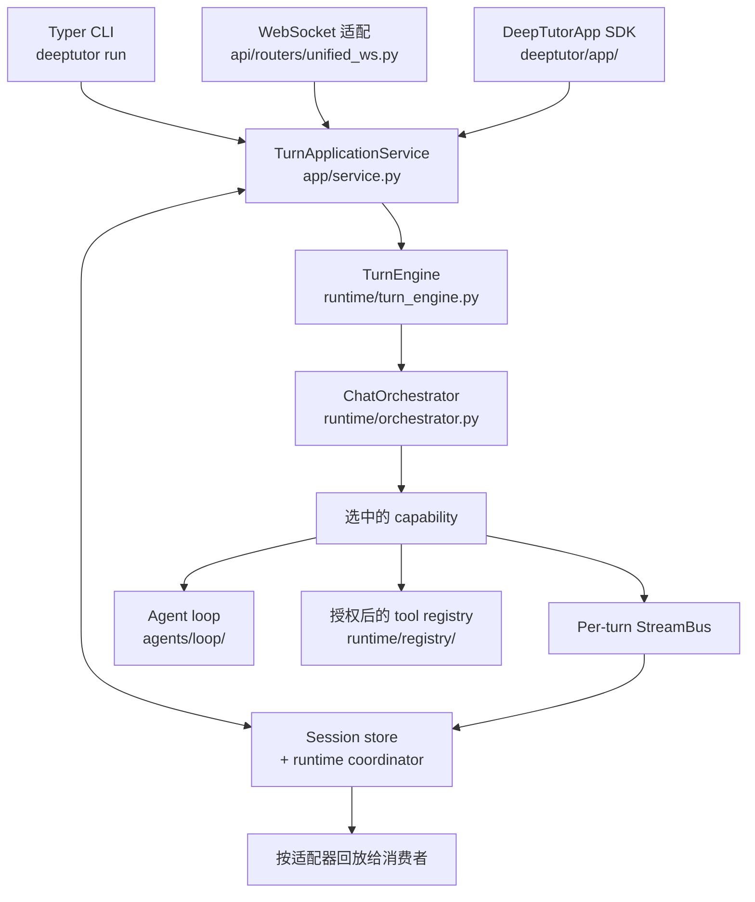

# DeepTutor 拆解

`HKUDS/DeepTutor` 是目前开源方案里最接近「一个能跟着孩子进度走的 AI 老师」的项目。这份文档讲它是什么、怎么实现、以及**对本仓库的实际可用性边界**——最后一部分是重点，因为它决定你能不能真的用上。

- 仓库：https://github.com/HKUDS/DeepTutor
- 文档站：https://deeptutor.info
- 论文：[arXiv 2604.26962](https://arxiv.org/abs/2604.26962)
- 数据源：`data/resources.json` 的 `repos` 段
- 核验时间：2026-11-09（GitHub API / PyPI / README / `docs-for-dev/` 源码目录）

---

## 一、基本事实

| 项 | 值 |
| --- | --- |
| 许可 | Apache-2.0 |
| 主力语言 | Python 21.4 MB + TypeScript 11.8 MB（另有 CSS 264 KB） |
| 仓库大小 | 258 MB |
| 创建 | 2025-12-28 |
| 最后 push | 2026-11-07 |
| Star / Fork / Open issue | 57,188 / 6,973 / 342 |
| 最新版 | v1.7.2（2026-11-06） |
| PyPI | `deeptutor==1.7.2`，`requires-python >=3.11,<3.15` |
| 发布物 | macOS dmg ×2（Apple Silicon / Intel）、Windows Setup.exe、Windows Portable.zip |

它不是「刷题工具」，也不是「课程平台」。定位是 **agent-native 的学习工作台**：把辅导、检索、创作、练习放进同一套可扩展运行时里。

---

## 二、怎么实现

### 一条链路

所有入口都收敛到同一个应用服务，再往下分发到具体 capability。



源码里明确的边界（引自 `docs-for-dev/ARCHITECTURE.md`）：

| 职责 | 归属 |
| --- | --- |
| CLI 解析与命令 | `deeptutor_cli/main.py` |
| SDK 门面与应用请求 | `deeptutor/app/` |
| 持久化准入、执行与回放 | `app/service.py` |
| 底层执行 | `runtime/turn_engine.py` |
| 上下文到 capability 的路由 | `runtime/orchestrator.py` |
| capability / tool 注册 | `runtime/registry/` |
| 共享对话循环 | `agents/loop/` |
| 会话与轮次生命周期 | `services/session/` |

`UnifiedContext`（`core/context.py`）是执行上下文。文档明确要求：入口必须走应用服务，**不能自己 new 一个 orchestrator 绕过持久化状态**。

### 工具 vs capability

两个协议分开：

- **Tool**：`BaseTool` / `ToolDefinition` / `ToolResult`（`core/tool_protocol.py`），一次由模型选择的操作。
- **Capability**：`TurnCapability` / `CapabilityManifest`（`core/capability_protocol.py`），拥有整轮，可以跑共享 loop 或分阶段 pipeline。

所有 capability 统一走 `emit_capability_result()`（`agents/_shared/capability_result.py`）产出结果信封，含 `cost_summary`。

**8 个用户可切换工具**（`tools/builtin/__init__.py` 的 `USER_TOGGLEABLE_TOOL_NAMES`）：

`brainstorm` / `web_search` / `paper_search` / `zotero_search` / `reason` / `geogebra_analysis` / `imagegen` / `videogen`

其余是上下文门控的：`rag` / `kb_files` / `knowledge_frontier` / `read_source` / `read_memory` / `write_memory` / `read_skill` / `load_tools` / `exec` / `web_fetch` / `ask_user` / `question_bank` / `github` / `consult_subagent` / `workspace_*` 等，按当轮上下文自动挂载。

### 模块化分发

1.7.0 起一个源码仓拆成多个独立发行的 Python 包。`deeptutor` 拥有共享运行时、CLI 与 SDK；功能包往同一命名空间加代码，不覆盖核心文件；`deeptutor-cli` 只是兼容元包，不含代码。`deeptutor[full]` 是**安装档位**，不是永久元包——这样单个应用还能单独卸掉。

`deeptutor/modules/manifests/` 下 25 个 JSON：

```
core  knowledge  solve  research  questions  reading  mastery  books
memory  notebook  partners  visualize  video-lesson  co-writer
audio-overview  calendar  parser-docling  parser-liteparse
parser-markitdown  parser-pymupdf4llm  parsing  providers
renderer-manim  server  web
```

三个状态是分开的：**installed**（装了）/ **enabled**（启用了）/ **ready**（依赖齐了）。`deeptutor module list` 查，`enable` / `disable` 改。

### 三层记忆：文件，不是向量库

这点和多数「AI 老师」项目不同——记忆刻意做成**可读可审计的文件**：

| 层 | 位置 | 内容 |
| --- | --- | --- |
| L1 | `memory/trace/<surface>/<date>.jsonl` | 追加式事件轨迹，工作区镜像 |
| L2 | `L2/<surface>.md` | 按 surface 整理的策展事实，引用 L1 实体 |
| L3 | `L3/<profile\|recent\|scope\|preferences>.md` | 跨 surface 的综合，记录贡献它的 L2 |

surface 覆盖 `chat` / `notebook` / `quiz` / `kb` / `book` / partner / `cowriter`。Memory Graph 展示整座金字塔，L2 → L1 有精确的证据边。合并器的 Update / Audit / Dedup 预算在 Settings → Memory 里调。

**为什么值得看**：它没把个性化藏进黑盒向量相似度里，而是落成 Markdown + JSONL，出问题能直接读文件定位。

### RAG：一个知识库绑一个引擎

可选引擎比同类项目多：

| 引擎 | 特点 |
| --- | --- |
| **LlamaIndex** | 默认。混合向量 + BM25，可选 cross-encoder 重排，精确 flat 或 HNSW FAISS 索引 |
| **PageIndex** | 推理式检索，页级引用，可托管可自建 OSS |
| **GraphRAG** / **LightRAG** | 知识图谱检索；LightRAG 内置，`pip install 'deeptutor[rag-lightrag]'` |
| **LightRAG Server** | 检索卸载到外部 LightRAG 实例，走 HTTP |
| **WeKnora** | 连自托管部署里的知识库，不落地本地索引与文档副本 |
| **Tencent IMA** | 在 IMA 里策展的库，通过 OpenAPI 搜索/浏览/回写 |
| **MarginNote 4** | MN4 学习数据（文档、摘录、脑图卡片及其连线）由 add-on 推入 |
| **Kiwix** | 直接搜服务端的 ZIM 档案，无需本地索引 |
| **Obsidian** | 连接 vault，原地读写 |

一个细节值得抄：**`deeptutor kb eval` 用指标打分而不是让模型主观评判**。

```bash
deeptutor kb eval <name> --dataset qa.jsonl --top-k 5 --mode hybrid --save baseline.json
deeptutor kb eval-diff baseline.json candidate.json
```

报告 `Recall@k` / `Precision@k` / `nDCG@k` / `MRR` / `MAP` / `Hit@k`，纯函数计算排序指标，不引入模型判断。PageIndex 返回的不是排序 chunk，所以被排除在外。

### 索引与重建

- 重建写新的 `version-N` 目录，保留旧版本，**重建过程中不会毁掉能用的索引**。
- 单文档可从 `error` 状态的知识库里单独移除，不必整库删了重建。
- 本地 LightRAG 查询与增量索引要求索引记录的 embedding 配置（模型、维度、endpoint 身份）一致；变了就得恢复原配置或整体重建。

### 文档解析

`Text-only` / `MinerU` / `Docling` / `Tika` / `markitdown` / `PyMuPDF4LLM` / `LiteParse` 七种，在 Settings → Knowledge & documents 选。Docling 可跑**远程模式**（连 Docling Serve，本地不装包不下模型）。Tika 只能远程。

### 运行时设计的两个关键选择

引自 `docs-for-dev/RUNTIME_DESIGN.md`：

1. **短生命周期解析 worker**。重同步抽取会把 native 库内存留在长驻 API 进程里，哪怕跑在线程里也一样。所以用 `runtime/isolated_worker.py` 起短命解释器，跑完退出释放内存。并发受 `DEEPTUTOR_ISOLATED_WORKERS` 限制（默认 2）。文档同时写清：**这是可信内部 IPC，不是沙箱**。
2. **私有 vs 展示的模型历史分离**。`services/session/model_history.py` 保留版本化的私有 `model_turn`（prepared input、快照、模型/工具消息、replay 元数据、请求指纹），对外响应与导出把它抹掉。压缩时必须保证工具调用与结果成对；被打断的工具给显式的「不可用」结果，而不是伪造一个成功响应。

### 数据边界

```
data/user/settings/                  # 管理员工作区 + 全局设置
data/users/<uid>/                    # 每个用户：聊天历史、记忆、笔记本、KB
data/partners/<id>/workspace/        # Partner（合成用户）作用域
data/cli-apps/                       # 已装 CLI app，只读挂进沙箱
data/system/                         # auth · grants · audit · user-secrets/<owner>
```

**`.env` 不是配置源**。运行时配置在 `data/user/settings/*.json`，或用 `DEEPTUTOR_HOME` / `deeptutor start --home` 指到别处。多用户下第一个注册用户成为管理员，其他人拿隔离工作区 + 授权范围内的模型/KB/skill/partner，拿不到原始 API key。

---

## 三、给 agent 用的接口

这是它对本仓库最关键的一点：**DeepTutor 本身就是设计成被另一个 agent 驱动的**。

仓库根目录自带 [`SKILL.md`](https://github.com/HKUDS/DeepTutor/blob/dev/SKILL.md)，是给外部 agent 的 CLI 交接文档。

```bash
# 一次性，机器可读：每行一个事件的 NDJSON，都带 session_id
deeptutor run deep_solve "Find d/dx[sin(x^2)]" --tool reason --format json

# 同一会话里链式多轮：抓 session_id 复用
SID=$(deeptutor run deep_research "Survey 2026 papers on RAG" \
  --config mode=report --config depth=standard --format json \
  | jq -r 'select(.type=="done").session_id')
deeptutor run deep_question "Quiz me on that survey" --session "$SID" --format json
```

headless 是安全的：没有 TTY 时 `ask_user` 暂停会自动用空回复解除，不会挂住。

capability 列表：`chat` / `ask_questions` / `deep_solve` / `deep_question` / `deep_research` / `visualize` / `math_animator` / `video_lesson` / `mastery_path` / `immersive_reading` / `audio_overview`。

`deeptutor doctor [--online] [--format json]` 查就绪状态，`--online` 会真的发一次模型请求。

---

## 四、对本仓库的可用性边界

三件事必须先知道，否则会白折腾。

### 1. 它是 MCP **客户端**，不是 MCP server

全仓 MCP 相关路径只有这两个方向（`git/trees` 全量搜 `mcp`）：

```
deeptutor/api/routers/mcp_settings.py     # 配置界面
deeptutor/api/routers/space_mcp.py
deeptutor/services/mcp/                   # client 侧：manager / oauth / secrets / catalog
deeptutor/services/mcp/catalog/vendor/curated.json
```

**没有把自身暴露为 MCP server 的实现**。所以它**不能像 `webdav-mcp-server` 那样挂进 Cursor 当工具**。要用它只有三条路：

- CLI：`deeptutor run ... --format json`
- HTTP / SSE：`deeptutor serve` 起 FastAPI 后端
- Python SDK：`DeepTutorApp.start_turn()`

反过来说，它**能挂别人的 MCP**——Settings → Personalization → MCP Services 里授权外部工具，走 `services/mcp/manager.py`。

### 2. 部署成本不低

- 默认端口 `3782`，后端 FastAPI + 前端 Next.js，需要 Node.js 20.9+（源码路径要 22 LTS）
- PyPI 全量装：`pip install -U "deeptutor[full]"`，然后 `deeptutor init` + `deeptutor start`
- Docker 一条命令可试：

```bash
docker run --rm --name deeptutor -p 127.0.0.1:3782:3782 \
  -v deeptutor-data:/app/data ghcr.io/hkuds/deeptutor:latest
```

- 模型必须自己配：`deeptutor init` 走端口 → LLM → embedding → search 向导。只用 Chat 和 Ask Questions 的话核心包够（`pip install deeptutor`，无 Node 依赖）

### 3. 和 Dify 不重叠，也不互替

| | Dify | DeepTutor |
| --- | --- | --- |
| 解决什么 | 知识库摄取 + 工作流编排 | 一个能跟着进度走的 agent 学习台 |
| 强项 | 数据源插件生态、可视化编排 | 学习活动（Book / Mastery Path / Reading / Practice）、可审计记忆、多引擎 RAG |
| 谁用它 | 开发者搭应用 | 学生（或家长）直接学 |
| 和本仓库的关系 | 把网盘 PDF 变成可检索知识库 | 把知识库变成有进度的学习过程 |

**本仓库的定位**是资源索引，两样都不装。这里只做两件事：记录它存在、记录它的真实边界。

---

## 五、如果要试，最小路径

```bash
# 1. 只跑 Chat，不装前端
pip install -U deeptutor
deeptutor init --cli
deeptutor doctor --online --format json

# 2. 接一个知识库再问
deeptutor kb create textbook --path ./某本教材.pdf
deeptutor run chat "第 3 章讲了什么" --kb textbook --format json
```

想看 Web 界面和 Book / Mastery Path，再走 `deeptutor[full]` 或 Docker。

**不建议**：一上手就装全量再配 embedding + search。`doctor` 先过一遍，缺什么补什么。

---

## 相关

- 开源项目总清单：[07-开源项目清单](07-开源项目清单.md)
- 工具选型与踩坑：[04-工具推荐](04-工具推荐.md)
- Dify 路线：[../dify/README.md](../dify/README.md)
