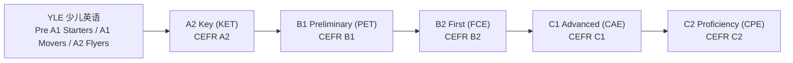

# 剑桥英语 KET（A2 Key）

KET 是剑桥英语考试体系的第一级，2020 年改版后官方名称统一为 **A2 Key**（青少版为 **A2 Key for Schools**），对应 CEFR 的 **A2**。

这篇文档回答三个常被问到但常被答错的问题：**国际上到底认不认**、**级别怎么判断、和 CET 是什么关系**、**小学初中应该达到什么水平**。所有结论都标注官方出处，末尾单列本文与流传文案不一致的地方。

> 全篇数据取自剑桥官方页面与文件，核验时间 2026-11。链接状态见 [03-参考网站](03-参考网站.md)。

---

## 一、名称与体系位置

两点需要说清：

1. **A2 Key 不是 CEFR 的起点**。在它下面是 YLE 三级的 A2 Flyers，二者同为 A2 级别，区别是 KET 开始有分数、有及格线、发的是"证书"而不是"盾牌"。
2. **A2 Key for Schools 与 A2 Key 是同一个资格**。难度、评分、证书效力完全相同，只是话题更贴近青少年生活。**证书上不印 "for Schools"**，用人单位与院校无法区分，也不需要区分。

## 二、考试结构

官方口径：**3 张试卷，约 2 小时**，覆盖听说读写四项技能。

| 试卷 | 时长 | 分值占比 | 题型 | 考察内容 |
| --- | --- | --- | --- | --- |
| Reading and Writing | 60 分钟 | **50%** | **7 部分 / 32 题** | 标志、宣传页、报刊短文等信息类文本；写作 2 篇：邮件回复（≥25 词）+ 看图写故事（≥35 词） |
| Listening | 30 分钟（含 6 分钟转涂答题卡） | **25%** | 5 部分 / 25 题 | 语速较慢的公告、对话、独白；选图、填空、匹配 |
| Speaking | 8-10 分钟（两名考生一组） | **25%** | 2 部分 | 与考官个人信息问答；与搭档围绕图片讨论 |

> 时长说明：三卷相加约 100 分钟，官方对外统一表述为 "about 2 hours"。口语 3 人一组时为 13-15 分钟。

**场景化是这套卷子的核心设计。** 题目围绕购物、问路、校园生活、通知公告这类真实任务，不考孤立语法点。官方 format 页每张试卷都附免费样题（Sample paper），备考最后一个月用样题熟悉题型，比再背新词有用。

## 三、评分与等级

A2 Key 的官方标注区间是 **120-139 分**，但成绩单可报到更低与更高的分数：低至 80 分（不合格但显示量表分），高至 150 分（Grade A）。**及格线 120**。

| 分数 | Grade | CEFR 级别 | 含义 |
| --- | --- | --- | --- |
| 140-150 | A | **B1** | 卓越。**证书上标注 B1 水平**，这是唯一的"跨级"机制 |
| 133-139 | B | A2 | 优秀，稳固的 A2 |
| 120-132 | C | A2 | 通过，获得 A2 认证 |
| 100-119 | Level A1 | A1 | 未通过 A2，但证明具备 A1 水平，发 A1 证书 |
| 80-99 | — | — | 只出成绩单（Statement of Results），**不发证书** |

**关于 "Grade A 等于 B1" 要知道的边界**：剑桥的判据是"该考生的作答表现落在 B1 描述语的覆盖范围内"，不是"已经学完 B1 的内容"。拿着 A 级证书去考 PET，仍然要按 PET 的题型准备。

---

## 四、问题一：国际上认可吗

**认可，但要分清"认可"和"够用"是两件事。**

### 官方表述

- A2 Key 证书被描述为 **"recognised around the world as a basic qualification in English"**（全球认可的基础级英语资格）。
- 剑桥英语资格的接收方覆盖 **"thousands of universities, employers and governments globally"**，可检索官方 recognition database 查询具体机构。
- 证书**没有有效期**：官方原文是 "Your Cambridge English exam result and certificate are valid indefinitely"——它证明的是"你在某个日期达到了某个水平"这一事实。

### 三条必须写明的边界

| 边界 | 事实 |
| --- | --- |
| 接收方可自设时效 | 剑桥明确"各机构可自行决定接受期限"；官方提到有些机构只接受近 2-3 年内的证书。签证类申请通常也要求近两年的成绩 |
| 认可 ≠ 满足门槛 | A2 是入门级。绝大多数院校的学位项目、以及多数工作与技术签证的语言门槛都在 B1 或 B2 以上，A2 Key 在这些场景中不构成资格 |
| 不能替代雅思/托福 | 雅思 4.0 对应量表 142-146 分。A2 Key 的**通过区间 120-139 整段低于雅思 4.0**，只有 Grade A（140-150，B1）才触及 4.0 的下沿 |

### 结论

**作为"能力已到 A2"的客观凭证，国际通行**；作为"留学或移民的语言门槛"，**不够用**。它的真实价值在第三条问题里更清楚——给孩子一个外部标尺，而不是一张通行证。

---

## 五、问题二：级别怎么判断，和 CET 是什么关系

### 判断 A2 的三个独立坐标

不要只用一种标准，三个坐标互相校验：

| 坐标 | A2 的位置 | 怎么查 |
| --- | --- | --- |
| CEFR 官方描述语 | "能理解与最直接相关领域（如个人与家庭信息、购物、周边地理、就业）的句子和常用表达；能在简单的日常任务中做直接的信息交换" | CEFR Global Scale Table 1 |
| 剑桥英语量表 | 标注区间 120-139，成绩单可报到 80-150 | 做一套官方样题，按卷面对照 |
| 学习时长 | 从零基础累计 **180-200 guided learning hours** | 剑桥官方给的是区间，不是承诺 |

官方给的全套累计学时（从零基础起算）：A1 90-100 小时、**A2 180-200** 小时、B1 350-400 小时、B2 500-600 小时、C1 700-800 小时、C2 1000-1200 小时。**每一级之间约 200 小时**，这个数字比"几年"好用得多。

### 和 CET 的对比：没有官方换算

这是最容易被含糊带过的地方，必须说清楚：

1. **CET-4 / CET-6 从未与 CEFR 建立官方对接。** 四六级是面向中国高校非英语专业学生的学业水平考试，剑桥、ETS 都没有与之做过分数量表对接。
2. 能引用的只有**间接链条**：教育部教育考试院主导的《中国英语能力等级量表》（CSE）与 CEFR 做过实证对接，结论是 `CSE 3` 覆盖大部分 A2 与较低 B1、`CSE 4` 主要对应 B1、`CSE 5` 覆盖 B1 上半段到 B2 下半段。学界与教学实践中普遍把 **CET-4 对应到 CSE 5**、CET-6 对应 CSE 6。
3. 因此可以给出**区间判断，不能给等号**：

| 对比 | 结论 | 强度 |
| --- | --- | --- |
| KET vs CET-4 | KET **明显低于** CET-4。CET-4 大致落在 CSE 5 ≈ B1-B2，KET 是 A2 | 可靠（间接链条，方向明确） |
| KET vs CET-6 | 差距更大，不在同一量级 | 可靠 |
| KET vs 雅思 | 通过区间（120-139）低于雅思 4.0；只有 Grade A（140-150）触及 4.0 下沿（142-146） | 可靠（剑桥官方量表直接换算） |

**一句话**：KET 是 A2，CET-4 大致落在 B1-B2，**KET 至少低一个 CEFR 级别**，不要写成"接近四级"。两者的构念也不同：CET-4 的口语是选考且单独计分，A2 Key 的口语占 25% 且必考，所以"四级分数高"不代表 A2 Key 的口语能拿分。

### 和中考的对比：词汇量接近，考点不同

| 维度 | A2 Key | 中考（课标三级） |
| --- | --- | --- |
| 词汇 | 官方词表 2025 年 8 月版，剑桥**未公布总数**，第三方按词条统计约 1700 个 | 课标要求约 **1600** 词 + 100-300 拓展词 |
| 语法 | 语言规范列 6 类时态（现在/现在进行/现在完成/过去/过去进行/将来），被动仅限一般现在与一般过去，从句限于 sure / know / think / hope / say / tell / if / when / where / because 引导 | 课标三级同列 6 类时态，但被动覆盖现在/过去/将来三种，非谓语含不定式与 -ing/-ed 三种形式，从句另要求宾语从句、状语从句与定语从句（辨认），并含主谓一致 |
| 听力 | 试卷固定 5 部分 25 题，含选图、填空、匹配；官方样题可听 | 课标三级要求"听懂发音清晰、语速较慢的简短口头表达，获取关键信息"；考试形式与语速由各地自定 |
| 口语 | **必考**，与考官及搭档面对面，占 25% | 课标未把口语列为统一考试内容，是否计分、如何计分由各地决定 |
| 写作 | 两篇 25-35 词的实用任务（邮件、看图写故事），占阅读写作卷的一部分 | 课标三级要求"能选用不同句式结构和时态，描述和介绍身边的人、事物或事件"；多数地区要求成篇作文 |

（中考一列各地差异较大，只引课标原文与全国普遍情况，不套用单一省市的卷面数据。）

结论：**两者不能互相替代**。KET 强在听说的真实使用与四技能均衡评分，课标三级则把语法体系列得更完整、书面表达要求成篇。

---

## 六、问题三：小学、初中应该达到什么水平

### 先把课标的分级摆出来

义务教育英语课程标准（2022 年版）按学段分三级，**注意：课标本身没有规定与 CEFR 的官方对应关系**，下表第二列是依据能力描述做的粗略对照，供定位用，不是官方结论。

| 课标级别 | 学段 | 词汇要求 | 与 CEFR 的粗略对照 |
| --- | --- | --- | --- |
| 一级 | 3-4 年级 | 26 个字母 + 基础拼读 | A1 前后 |
| 二级 | **5-6 年级** | 约 500 词 + 100-300 拓展 | **接近 A2 边缘** |
| 三级 | **7-9 年级** | 约 1600 词 + 100-300 拓展 | **B1 边缘** |
| 三级+ | 7-9 年级学有余力 | 约 1800 词 + 200 拓展 | B1 |

### 据此给出的水平期望

| 学段 | 合理目标 | 说明 |
| --- | --- | --- |
| 小学 1-3 年级 | 一级达标，**不建议考证** | 这个阶段的成果是"能读分级读物"，不是分数 |
| 小学 4-6 年级 | 二级达标；**输入量够的孩子可在 5-6 年级冲 A2 Key** | 前提见下方判断标准 |
| 初中 1-3 年级 | 三级达标；**A2 Key 已稳的可接 B1 Preliminary** | 不要在 A2 上反复刷分 |
| 高中 | B1-B2 区间，按升学路径选雅思/托福 | 见 [06-学习路线图](06-学习路线图.md) |

### 什么情况下才该报名，而不是"该考了"

用本仓库的判断标准，三条同时成立再报名：

1. **能读懂 A2 词表覆盖的短文**：随便翻开一本 A2 级别的分级读物，一页生词不超过 5 个（i+1 甜点区，见 [06-学习路线图](06-学习路线图.md)）；
2. **听力不需要字幕**：能听懂 2-3 分钟的无字幕对话并说出发生了什么——这正是 [06-学习路线图](06-学习路线图.md) 里六年级检查点的标准；
3. **做过一套官方样题且分数在 130 以上**：低于这个数说明还有 6-12 个月的输入量缺口，刷真题补不上。

**反面建议**：为了简历抢跑而报 KET，是本仓库明确反对的做法。A2 Key 的价值是"给现有能力一个外部确认"，不是"用证书倒逼学习"。输入量不够时，同样的时间花在动画、章节书、播客上收益高一个数量级——理由见 [05-学习方法论](05-学习方法论.md) 的"两个阶段，两种机制"。

---

## 七、报名与考试形式（中国大陆）

| 项 | 现状 |
| --- | --- |
| 统一报名入口 | **没有**。教育部考试中心报名网 `cyle.neea.edu.cn` 只服务剑桥**少儿**英语（Starters / Movers / Flyers），不适用于五级考试 |
| 官方指引 | 剑桥英语中国站对五级考试（A2 Key 及以上）的表述是"请关注我们接下来的官方发布"，未给出公开自助报名入口 |
| 实际做法 | 走官方 **Find a centre** 查授权考点，直接联系考点确认开放考期、费用与缴费方式 |
| 费用 | 各考点自行制定，**非全国统一价** |
| 考试形式 | 纸笔 与 机考并行。**标准版 A2 Key 的纸笔考试最后一次场次为 2026-12-03，之后停考**，仅保留机考；**A2 Key for Schools 的纸笔考试继续开考** |

**为什么停考标准版纸笔**：官方说明是考生越来越早达到 A2，标准版报考人数持续下滑，且超过一半的标准版考生年龄在 16 岁以下，已转向青少版或机考。对中小学生而言，**青少版纸笔或任一版本的机考都是可用路径**。

---

## 八、与本仓库路线图的衔接

| 路线图节点 | 与 KET 的关系 |
| --- | --- |
| 小学 4-6 年级（阶段四） | 阅读量爆发期。A2 Key 是这个阶段**可能**顺带达成的里程碑，不是必达指标 |
| 六年级检查点（阶段五） | 该检查点只看听力，与 A2 Key 的四技能测量不是同一件事。听力自由的孩子做 A2 Key 听力卷通常比较轻松，但写作与口语仍需按题型准备——这一条是本仓库的判断，不是剑桥的对应关系 |
| 初中（阶段六） | 学科英语阶段。英语已经自由的孩子此时应直接面向 B1 Preliminary，而不是停在 A2 |

具体见 [06-学习路线图](06-学习路线图.md)。

---

## 九、与流传文案不一致之处

以下三条在网络上流传很广，与剑桥官方现行口径不符，本文以官方为准：

| 说法 | 官方事实 | 出处 |
| --- | --- | --- |
| 标准版 A2 Key 纸笔考试"2026 年 6 月后停止" | 最后一次纸笔场次是 **2026-12-03**，之后停考。青少版纸笔继续 | Cambridge 支持站《Withdrawal of paper-based A2 Key in 2026》 |
| 阅读与写作"5 部分 / 30 题" | 2020 改版后为 **7 部分 / 32 题** | Cambridge A2 Key format 页 |
| "约 250 小时英语学习时长" | 剑桥官方口径是从零基础累计 **180-200 guided learning hours**；250 小时是部分地区机构的说法，无官方依据 | Cambridge 支持站《Guided learning hours》 |

另有一条需要谨慎对待的说法："通过 KET 相当于接近初中毕业英语水平"。**词汇量确实接近**（约 1700 vs 课标三级 1600），但**能力结构不同**——见第五节。写成"难度相当"会误导备考方向。

---

## 来源

| 内容 | 链接 |
| --- | --- |
| A2 Key 考试主页（级别、结构、纸笔停考说明） | [cambridgeenglish.org/exams-and-tests/qualifications/key/](https://www.cambridgeenglish.org/exams-and-tests/qualifications/key/) |
| 考试结构与分值 | [A2 Key exam format](https://www.cambridgeenglish.org/exams-and-tests/qualifications/key/format/) |
| 成绩、等级与 Cambridge English Scale | [Results for Cambridge English Qualifications](https://www.cambridgeenglish.org/exams-and-tests/qualifications/results/) |
| 证书有效期 | [How long are my results/certificate valid for?](https://support.cambridgeenglish.org/hc/en-gb/articles/202838296-How-long-are-my-results-certificate-valid-for) |
| 建议学习时长 | [Guided learning hours](https://support.cambridgeenglish.org/hc/en-gb/articles/202838506-Guided-learning-hours) |
| 标准版纸笔停考 | [Withdrawal of paper-based A2 Key in 2026](https://support.cambridgeenglish.org/hc/en-gb/articles/19607260953746-Withdrawal-of-paper-based-A2-Key-in-2026) |
| 量表与雅思换算 | [The methodology behind the Cambridge English Scale](https://www.cambridgeenglish.org/images/177867-the-methodology-behind-the-cambridge-english-scale.pdf) |
| A2 Key 官方词汇表（2025-08 版） | [Vocabulary List PDF](https://www.cambridgeenglish.org/Images/506886-a2-key-2020-vocabulary-list.pdf) |
| 全球认可机构检索 | [Who uses Cambridge English exams?](https://www.cambridgeenglish.org/why-choose-us/global-recognition/organisations/employers/who-uses-cambridge-english-exams/) |
| 课标（2022 年版）分级与词汇要求 | 《义务教育英语课程标准（2022 年版）》表 10、附录 3 |
| 中国英语能力等级量表 | [cse.neea.edu.cn](https://cse.neea.edu.cn/) |
| 大陆报名指引 | [报考剑桥英语证书系列考试](https://www.cambridgeenglish.cn/find-a-centre/find-a-schools-centre/) |
